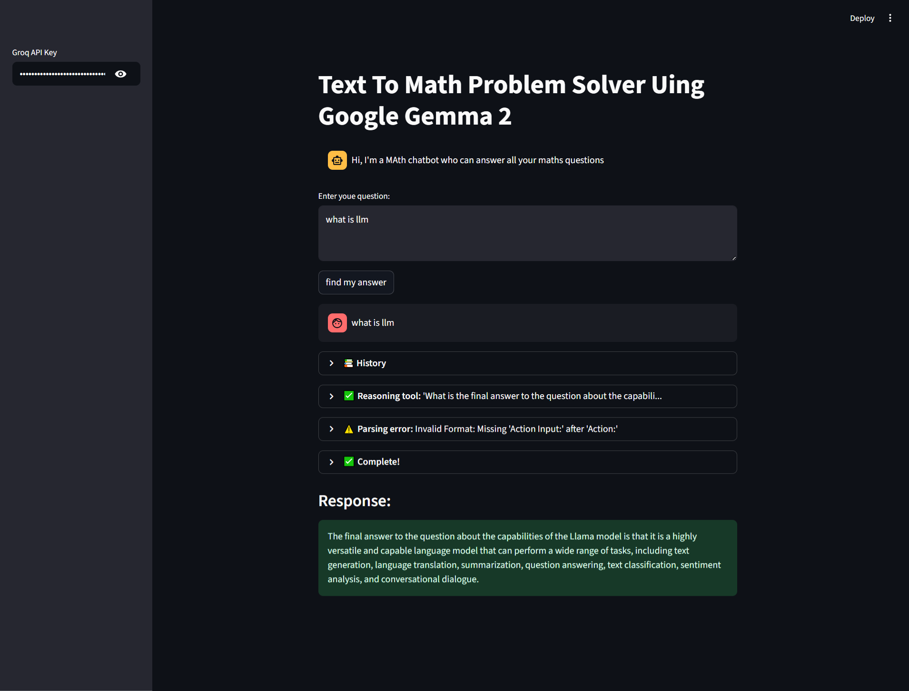
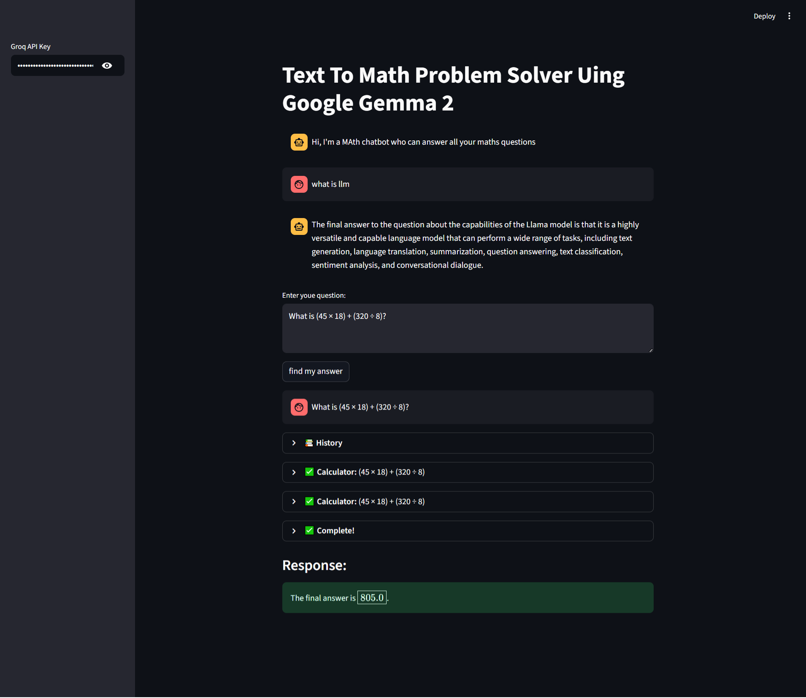

# Text to Math Problem Solver and Data Search Assistant

A **Streamlit-based AI assistant** that converts natural language math questions into solutions using **LangChain agents, tools, and the Groq-powered LLM (Gemma 2)**. The assistant can solve pure math calculations, word problems, and search for relevant information using Wikipedia.

**Text-to-Math Problem Solver and Data Search Assistant** is a Streamlit-based AI application that leverages **LangChain**, **Groq AI (Gemma 2)**, and **Wikipedia API** to solve mathematical problems and provide detailed, step-by-step reasoning for word problems. It also acts as a data search assistant for quick topic-based queries.  

The tool integrates multiple AI-powered components:
- **Groq LLM (ChatGroq)** for language understanding and reasoning
- **LLMMathChain** for mathematical calculations
- **Wikipedia API** for knowledge retrieval
- **Streamlit** for a user-friendly interactive interface

This project is ideal for demonstrating **AI, Natural Language Processing (NLP), LLM integration, and interactive data-driven applications**.

---

## Features

- **Math Problem Solver**  
  - Solves arithmetic and algebraic expressions using `LLMMathChain`.
  - Provides step-by-step reasoning for word problems.

- **Information Retrieval**  
  - Searches Wikipedia for relevant information using `WikipediaAPIWrapper`.

- **Agent-Driven Architecture**  
  - Utilizes `LangChain` agents to intelligently route queries to the correct tool.
  - Handles parsing errors and provides structured responses.

- **Interactive Web Interface**  
  - Built with `Streamlit` for easy question input and conversational interaction.
  - Maintains chat history with users.

---

## Technologies Used

- **LangChain**: For building agent-based AI workflows.
- **ChatGroq (Gemma 2)**: LLM for text understanding and reasoning.
- **Streamlit**: Web app interface.
- **LLMMathChain & LLMChain**: For mathematical reasoning and logical problem-solving.
- **WikipediaAPIWrapper**: For information search.

---

## 📸 Application Screenshots (Streamlit UI)

